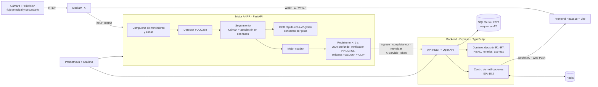

# Estado actual del sistema ANPR — ECU 911 Coordinación Zonal 3

Resumen de la arquitectura vigente (14 de octubre de 2026, rama `refactor/arquitectura-limpia`). El
detalle de cada parte está en los documentos enlazados; este archivo reemplaza la descripción de la
fase 0 (30 FPS, EasyOCR/PaddleOCR y video MJPEG), que ya no corresponde al sistema.

## 1. Qué hace el sistema

Registra el ingreso vehicular a partir del video de una cámara IP: detecta y lee la placa, decide el
acceso con la lista blanca (permisos con vigencia y horario) y la lista negra (alertas), guarda el
paso con su evidencia fotográfica y avisa al personal en tiempo real. El guardia confirma o corrige
las lecturas dudosas; nada se autoriza solo sin una lectura válida.

## 2. Arquitectura



## 3. Flujo de un paso vehicular

| Etapa | Implementación vigente | Detalle |
|---|---|---|
| Captura | RTSP desde MediaMTX (flujo principal de la cámara), cola de un solo cuadro: se analiza siempre el más reciente | [AUDITORIA_MOTOR_ANPR.md §1](docs/AUDITORIA_MOTOR_ANPR.md) |
| Movimiento | Compuerta de inferencia por diferencia de cuadros y MOG2, dentro del área de detección y fuera de las zonas de exclusión | [METODO_VERIFICACION_LECTURA.md §2.4](docs/METODO_VERIFICACION_LECTURA.md) |
| Detección | YOLO26n afinado en Open Images V7 (`models/license_plate_detector.pt`), 512 px, umbral 0,22, sobre el recorte del área de detección | [MODEL_CARD.md](services/anpr/models/MODEL_CARD.md) |
| Seguimiento | Asociación en dos fases al estilo ByteTrack con filtro de Kalman | AUDITORIA §1 |
| Lectura en vivo | fast-plate-ocr `cct-s-v2-global` (ONNX) por pista; consenso ponderado por confianza y nitidez | AUDITORIA §1 |
| Registro | Sobre la mejor foto, en paralelo: OCR profundo, verificador PP-OCRv6 medium (OpenVINO) y atributos del vehículo (YOLO26n + CLIP ViT-B-32). El paso se registra en menos de 1 s; lo que llega después se envía como reevaluación | AUDITORIA §4 |
| Validez | E1 formato ANT · E2 placa completa · E3 fila de caracteres · E4 confirmación · E5 lectura directa de cada carácter; «solo placas» (formato coherente con la forma del recuadro) | METODO §2.2 |
| Deduplicación | Un paso = un registro: misma placa en la misma cámara dentro de 35 s | AUDITORIA §2.2 |
| Decisión | Backend, regla R1–R7: las alertas nunca se rebajan; autorización automática solo con lectura válida, permiso vigente y confianza mínima | METODO §2.3 |
| Aviso | Notificación persistente por Socket.IO y Web Push, con reconocimiento, escalamiento y supresión de repeticiones | [NOTIFICACIONES.md](docs/NOTIFICACIONES.md) |

## 4. Interfaz web

Tres roles: **Guardia** (monitoreo, validación, registro manual, solicitudes), **Gestor de permisos**
(lista blanca y solicitudes, en una sola vista) y **Administrador** (todo). Colores institucionales,
barra de pestañas tipo IDE, dashboard con los 50 ingresos recientes en tiempo real y página *Estado
del sistema*. La placa se muestra siempre con la foto real del recorte. Detalle en
[SISTEMA_WEB.md](docs/SISTEMA_WEB.md) y [ROLES_Y_PERMISOS.md](docs/ROLES_Y_PERMISOS.md).

## 5. Estructura del repositorio

Backend, frontend y motor siguen arquitectura limpia; una prueba de aptitud en cada uno impide que una
capa interna dependa de una externa ([ARQUITECTURA_LIMPIA.md](docs/ARQUITECTURA_LIMPIA.md)).

```text
/ANPR
├── docker-compose.yml           # SQL Server, Redis, MediaMTX, backend, frontend, motor ANPR, Prometheus y Grafana
├── backend/src/                 # Express + TypeScript
│   ├── dominio/                 # Reglas puras: validación (placa ANT), permisos, decisión de acceso, horarios, alarmas
│   ├── aplicacion/              # Casos de uso por módulo y sus puertos
│   ├── infraestructura/         # Repositorios SQL, sesiones, Socket.IO, Web Push, correo, MediaMTX, motor ANPR
│   ├── interfaz/http/           # Routers, middlewares de sesión/permiso y catálogo OpenAPI (Swagger)
│   └── contenedor/              # Raíz de composición
├── frontend/src/                # React 18 + Vite + TypeScript
│   ├── dominio/                 # Validación, reglas, permisos, tipos y formato
│   ├── infraestructura/         # Cliente HTTP, Web Push, WebRTC, descargas, aviso sonoro
│   ├── aplicacion/              # Sesión, tiempo real y centro de notificaciones
│   └── interfaz/                # Componentes, páginas por rol y plantilla (menú y barra de pestañas)
├── services/anpr/               # Motor ANPR: Python + FastAPI
│   ├── app/dominio/             # Interpretación y validación de placas ecuatorianas (puro)
│   ├── app/aplicacion/          # Motor en tiempo real, detección, seguimiento, verificación, registro
│   ├── app/infraestructura/     # Modelos YOLO/OCR/CLIP, cámara, acceso al backend, métricas, configuración
│   ├── app/interfaz/            # Servidor HTTP y WebSocket
│   ├── models/                  # Pesos y MODEL_CARD.md
│   └── scripts/                 # Entrenamiento, evaluación A/B y estadística (McNemar, IC 95 %)
├── db/                          # init.sql y migraciones versionadas (v2 … v12)
├── mediamtx/ · monitoring/ · k8s/
└── docs/                        # Documentación técnica y resultados medidos (docs/resultados)
```

## 6. Base de datos

SQL Server 2022, esquema v12. Tablas principales: `DeteccionVehiculo` (cada paso con evidencia,
lectura, validez y decisión), `VehiculosAutorizados` (permisos de placa), `ListaNegra`,
`SolicitudesAcceso`, `Camaras` (credenciales RTSP cifradas, zonas), `Usuarios`, `Notificaciones` y
las tablas de auditoría. No hay usuarios, cámaras ni datos de prueba predefinidos. Detalle en
[BASE_DE_DATOS.md](docs/BASE_DE_DATOS.md).

## 7. Servicios y puertos

| Servicio | Contenedor | Puerto | Exposición |
|---|---|---|---|
| Frontend (React + Vite) | `anpr-frontend` | 3000 | red local |
| Backend API (Express) | `anpr-backend` | 5000 | red local |
| Motor ANPR (FastAPI) | `anpr-service` | 8000 | red local (solo WebSocket con ticket para el navegador) |
| MediaMTX | `anpr-mediamtx` | 8889 (WHEP), 8189 (WebRTC) · 8554 (RTSP) | WebRTC en la red local; RTSP solo en el equipo |
| SQL Server 2022 | `anpr-db` | 14333 → 1433 | solo `127.0.0.1` |
| Redis | `anpr-redis` | 6379 | solo `127.0.0.1` |
| Prometheus / Grafana | `anpr-prometheus` / `anpr-grafana` | 9090 / 3001 | solo `127.0.0.1` |

Cómo ejecutarlo: [EJECUTAR_SISTEMA.md](EJECUTAR_SISTEMA.md).

## 8. Verificación

- Pruebas (14 de octubre de 2026): backend 45 suites y 741 pruebas; motor 189; frontend 46. Todas en
  verde, con compilación TypeScript, lint y build del frontend.
- Mediciones del motor (registro en menos de 1 s, zonas, compuerta, interpretación de la placa) en
  [AUDITORIA_MOTOR_ANPR.md](docs/AUDITORIA_MOTOR_ANPR.md) y `docs/resultados/`.
- **Pendiente:** la cámara real de la garita no se ha probado con un flujo autorizado; las mediciones
  usan una cámara Hikvision simulada y recortes reales de 2 placas. El protocolo para validar en
  sitio está en [PROTOCOLO_EVALUACION_SECUENCIAS.md](docs/PROTOCOLO_EVALUACION_SECUENCIAS.md).
