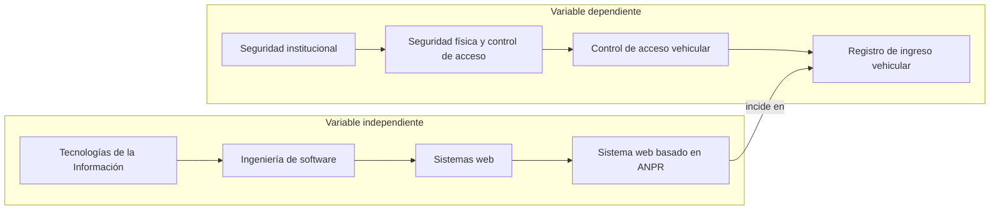
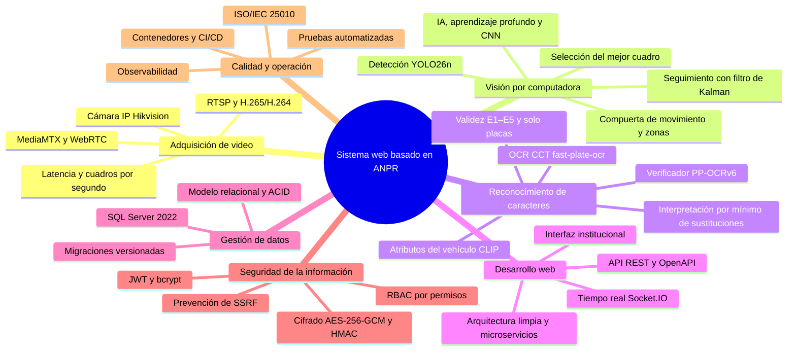
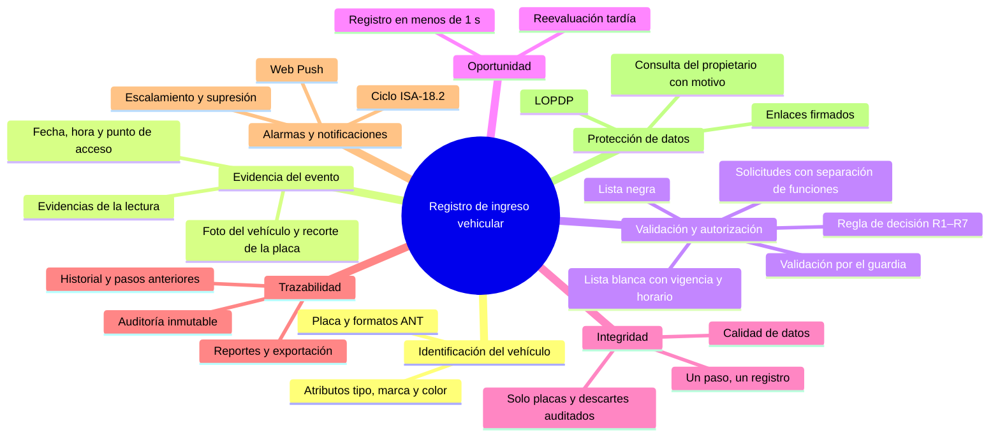
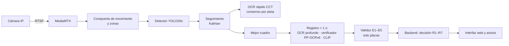

# Marco teórico · Sistema web basado en ANPR para el registro de ingreso vehicular

**Tema:** SISTEMA WEB BASADO EN ANPR PARA EL REGISTRO DE INGRESO VEHICULAR EN LA COORDINACIÓN ZONAL 3
DEL SERVICIO INTEGRADO DE SEGURIDAD ECU 911
**Universidad Técnica de Ambato · FISEI · Carrera de Ingeniería en Tecnologías de la Información**
**Área:** Gestión de Tecnologías de la Información · **Línea:** Software, Tecnologías de la Información y Ciencia de Datos
**Versión del documento:** 14 de octubre de 2026 (sistema en la rama `refactor/arquitectura-limpia`)

Este documento es la base para redactar el **Capítulo I (Marco teórico)** del informe final
(Anexo A). Organiza los conceptos según la **categorización de las variables** (superordinación y
subordinación), los fundamenta con fuentes y explica, en cada concepto, cómo se aplica en el sistema
tal como funciona hoy.

**Citas.** Formato IEEE con la numeración de la bibliografía de la tesis: [1]–[32] son las
referencias que ya están en el Anexo A; desde [33] son nuevas y su lista completa está en la
sección 9. Si la tesis usa el gestor de citas de Word, la numeración se reordena sola; si no, las
nuevas deben renumerarse en el orden en que aparezcan en el texto.

---

## 0. Qué cambió respecto a la versión anterior de este marco teórico

La versión anterior era una guía técnica genérica escrita en la fase inicial del proyecto. Varias de
sus afirmaciones ya no corresponden al sistema:

| Versión anterior | Sistema actual |
|---|---|
| OCR con EasyOCR / PaddleOCR y arquitectura CRNN + CTC | OCR rápido **fast-plate-ocr `cct-s-v2-global`** (transformador convolucional compacto, CCT) con 10 posiciones de carácter de longitud fija, sin CTC; segundo lector **PP-OCRv6 medium** con OpenVINO como verificador |
| YOLO genérico con pérdidas CIoU + DFL + BCE | **YOLO26n** afinado en Open Images V7: inferencia de extremo a extremo **sin NMS** y **sin DFL** [23] |
| Video a 30 FPS «sin latencia» y vista MJPEG | Cola de un solo cuadro (se analiza siempre el más reciente, 3–9 cuadros por segundo según la carga) y vista en vivo por **WebRTC** a través de MediaMTX |
| Selección del fotograma solo por varianza del Laplaciano | Compuerta de movimiento (diferencia de cuadros y MOG2), **zonas de exclusión**, seguimiento con filtro de Kalman, consenso de lecturas por pista y selector del mejor cuadro (nitidez, tamaño y distancia) |
| Corrección de homoglifos por posición, aplicada siempre | **Interpretación por mínimo de sustituciones**, que nunca agrega ni quita caracteres, y evidencia **E5 de lectura directa** de cada carácter |
| Sin regla de validez ni de decisión | Evidencias **E1–E5**, regla **«solo placas»** y regla de decisión **R1–R7** con lista blanca y lista negra |
| Sin tiempos de registro | Paso registrado en **menos de 1 s** desde la foto, con reevaluación tardía |
| Placas policiales «PP» y estatales «E» | Formatos que valida el sistema: particular (3 letras + 3 o 4 dígitos), motocicleta (2 letras + 3 dígitos + 1 letra), diplomática (CC, CD, OI, AT) y estatal corta (sección 5.4) |
| Referencia «Pezzimenti et al. (2011), IEEE Trans. Image Processing» | Retirada: no se encontró la obra. La varianza del Laplaciano se sustenta con Pertuz, Puig y Garcia [33] |
| Sin variables ni categorías | Organización por **variables, superordinación y subordinación** (secciones 1 y 2) |

---

## 1. Variables de la investigación

| | Variable | Definición conceptual |
|---|---|---|
| **Independiente** | **Sistema web basado en ANPR** | Aplicación web cliente-servidor que integra técnicas de visión por computadora y aprendizaje profundo para detectar y leer automáticamente las placas vehiculares en el video de una cámara IP, y pone esa información a disposición del personal autorizado mediante una interfaz web, una base de datos y avisos en tiempo real [6], [13], [34]. |
| **Dependiente** | **Registro de ingreso vehicular** | Proceso de control de acceso que identifica cada vehículo que ingresa a la institución y deja constancia verificable del evento (placa, fecha y hora, punto de acceso, evidencia fotográfica y decisión de acceso) para su consulta, auditoría y trazabilidad [35], [36]. |

**Relación entre las variables.** El sistema web basado en ANPR (causa) incide en el registro de
ingreso vehicular (efecto): automatiza la identificación del vehículo, reduce el tiempo de registro
y aumenta la exactitud, la integridad y la trazabilidad del registro frente al procedimiento manual
descrito en el diagnóstico (Capítulo III), donde el registro de un vehículo toma entre 1 y 5
minutos según el caso.

### 1.1 Operacionalización

| Variable | Dimensión | Indicador | Fuente de medición |
|---|---|---|---|
| VI | Detección de placas | Exhaustividad (recall), precisión y F1 del detector | Conjunto de prueba de Open Images; video de la garita |
| VI | Reconocimiento de caracteres | Exactitud de placa completa; CER | Recortes etiquetados; validaciones del personal |
| VI | Desempeño | Latencia por etapa; cuadros analizados por segundo | Métricas Prometheus del motor (`/status`, `/metrics`) |
| VI | Calidad del software | Pruebas automatizadas aprobadas; controles OWASP ASVS cubiertos | Suites de backend, motor y frontend; matriz de cumplimiento |
| VD | Oportunidad | Tiempo captura → registro (p50, p95, % por debajo de 1 s) | `docs/resultados/registro_rapido_2026-10-13.json`; evaluador de secuencias |
| VD | Exactitud | Placas registradas correctas; lecturas confirmadas erróneas | Validación del guardia (`placa_validada`) |
| VD | Integridad | Pasos duplicados; registros de objetos que no son placas | Base de datos; auditoría de descartes |
| VD | Trazabilidad | Pasos con evidencia completa (fotos, lectura, decisión, validador) | `DeteccionVehiculo`, `AuditoriaOperaciones` |
| VD | Respuesta | Latencia captura → notificación; tiempo de reconocimiento de alarmas | Métricas del centro de notificaciones |

---

## 2. Categorías fundamentales

La categorización ordena los conceptos de cada variable en dos direcciones:

- **Superordinación (red de inclusiones conceptuales):** de lo general a lo particular, cada
  categoría contiene a la siguiente. La relación es «es un tipo de / forma parte de»: un sistema web
  basado en ANPR *es un* sistema web; el registro de ingreso vehicular *forma parte del* control de
  acceso vehicular.
- **Subordinación (constelación de ideas):** desde la variable hacia sus componentes. La relación
  es «se compone de / se caracteriza por». Por eso la inteligencia artificial, la visión por
  computadora y el OCR aparecen en la subordinación de la variable independiente: son las
  tecnologías que la componen, no categorías que la contengan.

### 2.1 Red de inclusiones conceptuales (superordinación)

```text
        VARIABLE INDEPENDIENTE                                   VARIABLE DEPENDIENTE
┌─────────────────────────────────────────┐            ┌─────────────────────────────────────────┐
│ TECNOLOGÍAS DE LA INFORMACIÓN           │            │ SEGURIDAD INSTITUCIONAL                 │
│  ┌───────────────────────────────────┐  │            │  ┌───────────────────────────────────┐  │
│  │ INGENIERÍA DE SOFTWARE            │  │            │  │ SEGURIDAD FÍSICA Y CONTROL        │  │
│  │  ┌─────────────────────────────┐  │  │            │  │ DE ACCESO                         │  │
│  │  │ SISTEMAS WEB                │  │  │  incide en │  │  ┌─────────────────────────────┐  │  │
│  │  │  ┌───────────────────────┐  │  │  │ ─────────► │  │  │ CONTROL DE ACCESO VEHICULAR │  │  │
│  │  │  │ SISTEMA WEB BASADO    │  │  │  │            │  │  │  ┌───────────────────────┐  │  │  │
│  │  │  │ EN ANPR               │  │  │  │            │  │  │  │ REGISTRO DE INGRESO   │  │  │  │
│  │  │  └───────────────────────┘  │  │  │            │  │  │  │ VEHICULAR             │  │  │  │
│  │  └─────────────────────────────┘  │  │            │  │  │  └───────────────────────┘  │  │  │
│  └───────────────────────────────────┘  │            │  │  └─────────────────────────────┘  │  │
└─────────────────────────────────────────┘            │  └───────────────────────────────────┘  │
                                                       └─────────────────────────────────────────┘
```



**Justificación de cada nivel.**

| Nivel | Variable independiente | Por qué contiene al siguiente | Variable dependiente | Por qué contiene al siguiente |
|---|---|---|---|---|
| 1 | Tecnologías de la Información | Campo de la carrera y del área de investigación; incluye el desarrollo y la gestión del software | Seguridad institucional | Protección de las personas, bienes e información de una institución; en el ECU 911 es requisito de continuidad del servicio |
| 2 | Ingeniería de software | Disciplina de las TI que construye sistemas de software con métodos sistemáticos [27] | Seguridad física y control de acceso | Parte de la seguridad institucional que protege las instalaciones y regula quién entra [36], [37] |
| 3 | Sistemas web | Tipo de sistema de software con arquitectura cliente-servidor accesible desde el navegador [13] | Control de acceso vehicular | Control de acceso aplicado a los vehículos en los puntos de ingreso [2], [11] |
| 4 | **Sistema web basado en ANPR** | Sistema web que incorpora el reconocimiento automático de placas | **Registro de ingreso vehicular** | Actividad del control de acceso vehicular que deja constancia de cada ingreso |

### 2.2 Constelación de ideas de la variable independiente (subordinación)



| Dimensión | Subcategorías | Sección |
|---|---|---|
| Adquisición de video | Cámara IP, RTSP, códecs H.265/H.264, doble flujo, MediaMTX, WebRTC, latencia, FPS | 3.4.1 |
| Visión por computadora | IA, aprendizaje profundo, CNN, compuerta de movimiento y zonas, detección YOLO, seguimiento, selección del cuadro | 3.4.2–3.4.5 |
| Reconocimiento de caracteres | OCR, CCT, verificador PP-OCR, interpretación de la placa, validez de la lectura, atributos del vehículo | 3.4.6–3.4.8 |
| Desarrollo web | Arquitectura limpia, microservicios, REST, tiempo real, interfaz | 3.3 |
| Gestión de datos | Modelo relacional, transacciones, SQL Server, migraciones | 3.4.9 |
| Seguridad de la información | Autenticación, RBAC, cifrado, firma de enlaces, SSRF | 3.4.10 |
| Calidad y operación | Modelo de calidad, pruebas, contenedores, observabilidad, métricas | 3.2 y 3.4.11–3.4.12 |

### 2.3 Constelación de ideas de la variable dependiente (subordinación)



| Dimensión | Subcategorías | Sección |
|---|---|---|
| Identificación del vehículo | Placa, formatos de placa ecuatoriana, atributos del vehículo | 4.4.1 |
| Evidencia del evento | El registro como evidencia, datos y fotografías del paso | 4.4.2 |
| Validación y autorización | Listas blanca y negra, permisos temporales, regla de decisión, humano en el bucle, solicitudes | 4.4.3 |
| Oportunidad | Tiempo de registro, reevaluación, tiempo de aviso | 4.4.4 |
| Integridad | Deduplicación, regla «solo placas», descartes auditados, calidad de datos | 4.4.5 |
| Trazabilidad | Historial, auditoría, reportes | 4.4.6 |
| Alarmas y notificaciones | Ciclo de vida de la alarma, escalamiento, fatiga de alarmas | 4.4.7 |
| Protección de datos personales | Principios de la LOPDP aplicados | 4.4.8 |

### 2.4 Relación entre las dimensiones de las variables

| Dimensión de la VI | Dimensión de la VD a la que aporta | Mecanismo en el sistema |
|---|---|---|
| Adquisición de video | Evidencia del evento | Foto del vehículo y recorte de la placa por cada paso |
| Visión por computadora | Identificación, integridad | Detección y seguimiento: un vehículo genera una sola pista y un solo paso |
| Reconocimiento de caracteres | Identificación, exactitud | Lectura de la placa con dos lectores independientes y evidencias de validez |
| Desarrollo web | Oportunidad, trazabilidad | Registro y aviso en tiempo real; historial consultable |
| Gestión de datos | Trazabilidad, integridad | Persistencia transaccional y auditoría de solo inserción |
| Seguridad de la información | Protección de datos, validación | Acceso por permisos, credenciales cifradas, enlaces firmados |
| Calidad y operación | Todas | Pruebas automatizadas, mediciones A/B y monitoreo |

---

## 3. Fundamentación teórica de la variable independiente

### 3.1 Tecnologías de la Información

Las tecnologías de la información comprenden el hardware, el software, las redes y los datos con
que una organización obtiene, procesa, almacena y distribuye información. En la Coordinación
Zonal 3 del ECU 911 ya existe infraestructura de TI para la vigilancia (cámaras fijas, PTZ e IP) [4],
[5], pero parte de ella cumple solo funciones de observación y grabación, sin analítica que
identifique vehículos [3], [4]. El proyecto aprovecha esa infraestructura con software: no reemplaza
la cámara, sino que extrae información del flujo de video que ya entrega.

### 3.2 Ingeniería de software

La ingeniería de software aplica enfoques sistemáticos, disciplinados y cuantificables al
desarrollo, la operación y el mantenimiento del software [27]. En este proyecto se manifiesta en
cuatro prácticas:

- **Arquitectura limpia.** Las reglas del negocio (dominio) no dependen de la base de datos, del
  framework web ni de los modelos de IA; las dependencias apuntan hacia el dominio y los detalles
  técnicos quedan en adaptadores intercambiables [38]. En el sistema, backend, frontend y
  motor tienen las capas *dominio*, *aplicación*, *infraestructura* e *interfaz*, y una prueba de
  aptitud en cada componente impide que una capa interna dependa de una externa.
- **Modelo de calidad.** ISO/IEC 25010 define las características de calidad del producto
  (adecuación funcional, eficiencia de desempeño, compatibilidad, usabilidad, fiabilidad,
  seguridad, mantenibilidad y portabilidad) [39]. El repositorio mantiene una matriz que
  asocia cada característica con su evidencia verificable (`docs/CUMPLIMIENTO_NORMAS.md`).
- **Pruebas automatizadas.** Pruebas unitarias del dominio, de casos de uso con dobles de prueba, de
  integración de la API (matriz rol × ruta), de contrato (OpenAPI) y de aceptación de extremo a
  extremo. Al 14 de octubre de 2026: backend 741 pruebas en 45 suites, motor 189 y frontend 46,
  todas aprobadas; la prueba de aceptación sobre SQL Server real aprobó 70 de 70 comprobaciones.
- **Decisiones basadas en evidencia.** Cada cambio del motor que altera su comportamiento se mide
  con un experimento A/B pareado y se adopta o descarta según el resultado; las proporciones se
  comparan con la prueba de McNemar [40] y se informan con intervalos de confianza de
  Wilson [41]. Las fichas de modelo documentan datos, métricas y limitaciones de cada
  modelo de aprendizaje automático [42].

### 3.3 Sistemas web

Un sistema web es una aplicación que se ejecuta en el navegador sobre una arquitectura
cliente-servidor y sirve para organizar, almacenar y consultar información [13]. El servidor expone
sus operaciones mediante una API; en el estilo REST, cada recurso se identifica por una URL y se
manipula con las operaciones estándar de HTTP, sin estado de sesión en el servidor [43].

**Arquitectura del sistema.** La solución se divide en servicios independientes, cada uno en su
contenedor [44]:

| Servicio | Tecnología | Función |
|---|---|---|
| Frontend | React 18 + Vite + TypeScript [45], [46] | Interfaz por roles, video en vivo, avisos |
| Backend | Node.js + Express + TypeScript [47], [48] | API REST documentada con OpenAPI, reglas de acceso, notificaciones |
| Motor ANPR | Python + FastAPI [49] | Detección, seguimiento, lectura y registro de los pasos |
| Base de datos | SQL Server 2022 [50] | Persistencia transaccional |
| Video | MediaMTX [51] | Distribución del video de la cámara al motor y a los navegadores |
| Caché y mensajería | Redis | Reparto de eventos entre instancias del backend |
| Observabilidad | Prometheus + Grafana | Métricas de latencia, exactitud y alarmas |

**Tiempo real.** El protocolo WebSocket mantiene una conexión bidireccional y persistente entre el
navegador y el servidor sobre una sola conexión TCP [52]; Socket.IO agrega salas, reconexión
automática y recuperación de eventos [53]. El sistema lo usa para que cada paso, alerta o
cambio de estado aparezca en pantalla sin recargar ni consultar periódicamente. Para avisar con la
pestaña cerrada se usa Web Push, protocolo estándar de entrega de eventos por HTTP [54] con
identificación del servidor por VAPID [55]. El patrón de fondo es la publicación/suscripción:
el productor del evento no conoce a sus receptores [56].

**Interfaz de usuario.** La interfaz aplica los colores institucionales del Centro de Control (rojo
ECU 911, barra lateral carbón y fondo gris claro), densidad compacta y una barra de pestañas tipo IDE
con las vistas que permite el rol. El dashboard del administrador muestra indicadores del día, la
distribución de los ingresos, los últimos 7 días y los **50 ingresos recientes** actualizados en
tiempo real. La placa se presenta siempre con la **foto real del recorte** que guardó el motor,
junto a la lectura en texto; si el motor no pudo recortarla, la interfaz lo indica en lugar de
mostrar la foto del vehículo como si fuera la placa. Así el guardia compara la lectura con la
evidencia original en cada pantalla.

### 3.4 Sistema web basado en ANPR

El reconocimiento automático de placas (ANPR o ALPR) comprende las etapas de adquisición de la
imagen, detección de la placa, segmentación o reconocimiento de caracteres y validación del
resultado [6], [34]. Los sistemas actuales sustituyen las técnicas clásicas de bordes y
contornos por detectores y reconocedores de aprendizaje profundo, con los que la detección y la
lectura funcionan en tiempo real e independientemente del diseño de la placa [57],
[58], incluso en escenarios no controlados [59]. Un sistema web basado en ANPR
centraliza esos resultados en una base de datos consultable por el personal, de modo que el
registro deja de depender de anotaciones manuales [8], [9], [10].



#### 3.4.1 Adquisición y transmisión de video

**Cámara IP.** La garita cuenta con una cámara Hikvision DS-2CD1123G0E-I (H.265+, 1920×1080) [28].
Es una cámara de vigilancia gran angular, no una cámara ANPR dedicada: el reconocimiento lo hace el
software. El sistema usa su **doble flujo**: el principal (1080p, H.265 o H.264) para el motor y el
secundario (640×360, H.264) para la vista en el navegador.

**RTSP.** Protocolo de nivel de aplicación para establecer y controlar sesiones de transmisión
multimedia en tiempo real entre una cámara y un cliente [24]. El motor no se conecta a la cámara:
lee la ruta RTSP interna de MediaMTX que le asigna el backend.

**Códecs.** H.264 y H.265 (HEVC) comprimen el video aprovechando la redundancia entre cuadros;
H.265 reduce la tasa de bits a igual calidad. Las variantes «inteligentes» (H.265+) bajan aún más la
tasa con intervalos de cuadros clave largos, lo que conviene evitar en el flujo de reconocimiento.

**MediaMTX y WebRTC.** MediaMTX abre la cámara una sola vez y reparte el flujo al motor (RTSP
interno) y a los navegadores (WebRTC con señalización WHEP), sin transcodificar [51]. El
retardo típico de la vista en red local es de 0,2 a 0,5 s.

**Latencia y cuadros por segundo.** La latencia es el tiempo entre la captura y el resultado; los
FPS, el número de cuadros procesados por segundo. El motor usa una **cola de un solo cuadro**:
analiza siempre el más reciente y descarta los intermedios, para no trabajar nunca sobre video
atrasado. En el portátil de desarrollo (CPU, sin GPU) analizó una mediana de 3,8 cuadros por segundo
en una jornada de mediciones y de 8 a 9 en otra, según la carga del equipo, mientras la edad del cuadro al analizarlo se mantiene en decenas de milisegundos (p50 de
15 a 29 ms con la cámara simulada).

#### 3.4.2 Inteligencia artificial, aprendizaje profundo y visión por computadora

La **inteligencia artificial** estudia el diseño de agentes que perciben su entorno y actúan para
alcanzar objetivos [60]. Su rama de **visión por computadora** busca que un sistema
obtenga información útil de imágenes y video [61]. El **aprendizaje profundo** aprende
representaciones de los datos con redes de muchas capas, cada una más abstracta que la anterior
[62]; las **redes neuronales convolucionales (CNN)** aplican filtros que se comparten en
toda la imagen y extraen bordes, texturas y formas [63]. La **transferencia de aprendizaje**
reutiliza un modelo entrenado en una tarea para otra con menos datos [64]: es lo que permite
afinar un detector general para que encuentre placas.

#### 3.4.3 Compuerta de movimiento y zonas de la cámara

**Sustracción de fondo.** El modelo de mezcla de gaussianas adaptativo (MOG2) aprende el fondo de
la escena píxel a píxel y marca como primer plano lo que se aparta de él [65],
[66].

**Aplicación en el sistema.**

- *Compuerta de inferencia:* el detector solo se ejecuta si la escena cambió desde la última
  inferencia (diferencia absoluta tras suavizado gaussiano, al menos 0,2 % del área). En 12
  secuencias compuestas, las inferencias bajaron de 132 a 57,4 por secuencia (−56,5 %) sin retrasar
  ninguna detección.
- *Área de detección y zonas de exclusión:* el administrador dibuja sobre el video el carril y hasta
  8 polígonos donde hay movimiento falso (árboles, banderas, reflejos). En una escena con árboles que
  se mecen, las pistas falsas pasaron de 427 cuadros a 0 y las inferencias del 77,4 % al 56,3 % de
  los cuadros, con las placas reales detectadas igual (320 frente a 319 cuadros).
- *Recorte de la región:* el detector analiza solo el rectángulo del área de detección, con más
  píxeles por placa. En la prueba de Open Images (2 816 placas) la detección pasó del 83,6 % al
  85,7 %, y en las placas pequeñas del 37,9 % al 47,5 % (McNemar, p < 10⁻⁸).

#### 3.4.4 Detección de placas con YOLO

YOLO formula la detección de objetos como un único problema de regresión sobre la imagen completa,
en una sola pasada de la red, lo que la hace apta para tiempo real [67]. La familia ha
evolucionado hasta YOLO26 (Tabla 3 del Anexo A) [21], [22], que elimina la supresión de no máximos
(NMS) y la *Distribution Focal Loss* para una inferencia de extremo a extremo, y mejora la detección
de objetos pequeños y la velocidad en CPU [23].

La coincidencia entre una caja predicha $B$ y la real $B_{gt}$ se mide con la intersección sobre la
unión:

$$\text{IoU} = \frac{|B \cap B_{gt}|}{|B \cup B_{gt}|}$$

**Aplicación en el sistema.** El detector de producción es **YOLO26n afinado en Open Images V7**
[68] (5 362 imágenes de entrenamiento, una clase: placa), con entrada de 512 px y umbral
de confianza 0,22 (umbral bajo ≈ 0,055 para el seguimiento). Reemplazó a un YOLOv8n preentrenado
tras una comparación en el conjunto de prueba de Open Images (2 048 imágenes, 2 816 placas):

| Modelo | Precisión | Exhaustividad | F1 (IC 95 %) | ms CPU OpenVINO (p95) |
|---|---|---|---|---|
| YOLOv8n (anterior) | 90,5 % | 46,2 % | 0,611 (0,593–0,630) | 25,3 (32,3) |
| **YOLO26n afinado (producción)** | **93,8 %** | **81,5 %** | **0,873 (0,860–0,884)** | **24,0 (31,9)** |

YOLO26n detectó 1 007 placas que YOLOv8n perdió y YOLOv8n 11 que YOLO26n perdió (McNemar
χ² = 972,5). Limitación: Open Images no contiene placas ecuatorianas; falta validar con video de la
garita.

#### 3.4.5 Seguimiento y selección del mejor cuadro

El **filtro de Kalman** estima el estado de un sistema dinámico (aquí, la posición y velocidad de la
caja de la placa) combinando una predicción con la medición ruidosa de cada cuadro [69].
**ByteTrack** asocia primero las detecciones de alta confianza con las trayectorias y después
recupera las de baja confianza, para no perder un objeto ocluido o borroso [70].

La **nitidez** de un cuadro se estima con medidas de enfoque como la varianza de la respuesta al
operador Laplaciano: a mayor varianza, más bordes definidos [33].

$$\text{Nitidez} = \text{Var}(\nabla^2 I) = \frac{1}{N}\sum_{x,y}\left((\nabla^2 I)(x,y) - \mu_{\nabla^2 I}\right)^2$$

**Aplicación en el sistema.** El motor asocia en dos fases al estilo ByteTrack, con filtro de Kalman;
una pista sigue viva hasta 4 cuadros analizados sin detección. Cada pista acumula lecturas rápidas
(consenso ponderado por confianza y nitidez) y el selector elige la mejor foto del paso por nitidez,
tamaño y distancia, con hasta 3 intentos si una foto resulta ilegible. El OCR en vivo no lee placas
cortadas por el borde lateral del cuadro, para que una lectura truncada («SY589» por «PSY589») no
vote en el consenso.

#### 3.4.6 Reconocimiento óptico de caracteres (OCR)

El OCR convierte los caracteres de una imagen en texto procesable por un sistema [16], [17]. En
ANPR lee la placa previamente localizada. Hay dos familias de reconocedores:

- **Con alineación CTC.** La clasificación temporal conexionista entrena una red sobre secuencias sin
  segmentar, alineando la salida con el texto sin marcar dónde está cada carácter [71]. Es
  la base de los reconocedores de texto en escena como los de PP-OCR [72].
- **Con posiciones de longitud fija.** El modelo tiene una cabeza de clasificación por posición del
  texto; las posiciones sobrantes se rellenan con un carácter especial.

Los **transformadores** procesan la imagen como una secuencia de fragmentos relacionados por
mecanismos de atención; los **transformadores convolucionales compactos (CCT)** combinan una
tokenización convolucional con un transformador pequeño, y funcionan bien con pocos datos y en CPU
[73].

**Aplicación en el sistema.**

| Lector | Modelo | Funcionamiento | Exactitud en 77 recortes reales |
|---|---|---|---|
| OCR rápido (en vivo y en el registro) | fast-plate-ocr `cct-s-v2-global` (ONNX) [32] | CCT con 10 posiciones fijas, alfabeto de 36 caracteres más relleno, entrada 64×128 | 89,6 % |
| Verificador (segundo lector independiente) | PP-OCRv6 medium con OpenVINO [74] | Detección y reconocimiento de texto de PaddleOCR; media 85 ms, p95 194 ms | 96,1 % |

OpenVINO optimiza la inferencia de los modelos en CPU de Intel [75]. Un modelo OCR
afinado con placas ecuatorianas sintéticas quedó como candidato y **no** se promovió: en días no
vistos no mejoró (77,8 % frente a 77,8 %).

#### 3.4.7 Validez de la lectura

Un umbral único de confianza no distingue una placa bien leída de un rótulo, una placa truncada o
una lectura borrosa con confianza alta. Por eso el sistema, inspirado en la arquitectura de OpenALPR,
evalúa evidencias independientes antes de aceptar una lectura:

| Evidencia | Qué comprueba |
|---|---|
| E1 · Formato | La lectura corresponde a un formato de placa ecuatoriana (sección 5.4) |
| E2 · Placa completa | La caja no toca el borde del cuadro |
| E3 · Geometría | Hay una fila de caracteres alineados en el recorte (binarización de Otsu y adaptativa [76], componentes conexas y bordes por transformada de Hough [77]) |
| E4 · Confirmación | Dos lecturas idénticas en cuadros distintos, o el verificador coincide |
| E5 · Lectura directa | Cada carácter lo leyó tal cual algún lector; un carácter que solo existe por sustitución es una hipótesis |

**Interpretación por mínimo de sustituciones.** Los lectores confunden caracteres de forma parecida
(homoglifos: 0/O, 1/I, 5/S, 8/B). La lectura se interpreta como el formato que la explica con
**menos** sustituciones; cada sustitución queda registrada y nunca se agregan ni quitan caracteres.
Antes se forzaba el formato de automóvil: una moto bien leída (AB123A) se convertía en otra placa.
En 77 recortes reales la interpretación nueva no cambió ninguna decisión (74/77 placas correctas en
ambas versiones; McNemar 0 frente a 0).

**Regla «solo placas».** Las placas de automóvil son alargadas y de una fila; las de motocicleta,
casi cuadradas. Una lectura con formato de moto dentro de un recuadro de placa de auto se trata como
foto ilegible. En una prueba con texto de teclado y pantalla, la regla eliminó los 4 falsos registros
y las 4 lecturas incompletas de una placa real, sin rechazar ninguna lectura correcta de los 77
recortes.

**Placa registrada.** Cuando el verificador lee una placa con formato válido, esa es la que se
registra (es el lector más exacto); si los dos lectores discrepan, E4 no se cumple y el paso queda
para revisión del guardia.

#### 3.4.8 Atributos del vehículo

CLIP aprende a relacionar imágenes y textos, y puede clasificar una imagen comparándola con
descripciones escritas sin entrenamiento específico para la tarea [78]. El sistema recorta
el vehículo con un detector YOLO26n y estima tipo, color y marca con CLIP ViT-B-32. Es el **segundo
factor** de la decisión: si el vehículo observado no coincide con el registrado para esa placa, un
paso autorizado pasa a revisión (posible placa clonada) [7].

#### 3.4.9 Gestión de datos

El **modelo relacional** organiza los datos en relaciones (tablas) y los consulta con un lenguaje
declarativo [79]; las **transacciones ACID** (atomicidad, consistencia, aislamiento y
durabilidad) garantizan que una operación se aplique completa o no se aplique [80]. El
sistema usa SQL Server 2022 [14], [50] con el esquema en su versión 12; cada migración
se registra con su suma SHA-256 y se aplica una sola vez. No hay usuarios, cámaras ni datos de prueba
predefinidos.

#### 3.4.10 Seguridad de la información

| Mecanismo | Fundamento | Aplicación en el sistema |
|---|---|---|
| Sesión con JWT | Token firmado con afirmaciones sobre el usuario [81] | Sesión en `sessionStorage` con expiración; el rol se relee de la base en cada solicitud |
| Contraseñas con bcrypt | Función de derivación lenta y con sal [82] | 12 rondas; bloqueo de 15 min tras 5 intentos fallidos |
| Control de acceso basado en roles | Usuarios → roles → permisos [83], [84] | Tres roles (Administrador, Guardia, Gestor de permisos) y matriz única de permisos |
| Permisos temporales | RBAC temporal [85], [86] | Permisos de placa con vigencia y franjas horarias |
| Cifrado autenticado | AES en modo GCM [87] | Contraseñas RTSP cifradas con AES-256-GCM en la base |
| Firma de enlaces | HMAC [88] | La evidencia fotográfica solo se entrega con enlace firmado y con vencimiento |
| Prevención de SSRF | Riesgo A10 de OWASP Top 10:2021 [89] | Las cámaras solo pueden estar en las redes permitidas; se rechazan enlace local y multidifusión |
| Verificación de seguridad | OWASP ASVS 4.0.3 [90]; ISO/IEC 27001:2022 [91] | Matriz de controles con su evidencia en el repositorio |

#### 3.4.11 Despliegue y operación

Los contenedores empaquetan cada servicio con sus dependencias y se ejecutan igual en cualquier
equipo con Docker [44]. El sistema se levanta con Docker Compose (base de datos, Redis,
MediaMTX, backend, frontend, motor, Prometheus y Grafana) y tiene manifiestos de Kubernetes para
producción. La integración continua compila, prueba y analiza las imágenes con Trivy en cada cambio.

#### 3.4.12 Métricas de evaluación

| Métrica | Fórmula o definición |
|---|---|
| Precisión | $P = \frac{TP}{TP + FP}$ |
| Exhaustividad (recall) | $R = \frac{TP}{TP + FN}$ |
| F1 | $F_1 = 2\,\frac{P \cdot R}{P + R}$ |
| Exactitud de placa completa | Placas leídas sin ningún error / placas evaluadas |
| CER | $\text{CER} = \frac{S + D + I}{N}$ (sustituciones, eliminaciones e inserciones de la distancia de edición entre la lectura y la placa real de $N$ caracteres) |
| Latencia | Captura → lectura visible; captura → registro; captura → notificación (p50 y p95) |
| Comparación pareada | Prueba de McNemar para proporciones [40]; prueba de rangos con signo de Wilcoxon para tiempos [92]; intervalos de Wilson [41] y bootstrap [93] |

---

## 4. Fundamentación teórica de la variable dependiente

### 4.1 Seguridad institucional

La seguridad institucional protege a las personas, los bienes, la información y la continuidad de
las operaciones de una organización. El ECU 911 coordina la atención de emergencias de Cotopaxi,
Chimborazo, Pastaza y Tungurahua desde Ambato [4], [5]; su sede es parte de la infraestructura de
la que depende ese servicio. Las infraestructuras críticas son interdependientes: la falla de una
afecta a las que dependen de ella [94]. Por eso controlar quién ingresa a la sede es un
requisito de seguridad y no solo un trámite administrativo. La sede, además, está en un sector con
reportes recientes de inseguridad [12].

### 4.2 Seguridad física y control de acceso

La seguridad física protege las instalaciones mediante funciones de **detección, retardo y
respuesta** frente a un intruso [36]. El control de acceso físico define quién puede
ingresar, por dónde y cuándo, y registra los ingresos: ISO/IEC 27002 lo establece en sus controles
de perímetros y entrada física [37] y NIST SP 800-53 en el control PE-3 [95].

### 4.3 Control de acceso vehicular

El control de acceso vehicular aplica esos principios a los vehículos: identifica cada vehículo en el
punto de ingreso, verifica si está autorizado y decide si pasa. Los sistemas basados en
reconocimiento de placas automatizan la identificación y el cotejo con listas de vehículos
autorizados y de alerta [2], [11]. En la Coordinación Zonal 3 este control se realiza hoy con
procedimientos manuales del personal de seguridad física.

### 4.4 Registro de ingreso vehicular

#### 4.4.1 Identificación del vehículo

La placa es el identificador legal del vehículo; su formato lo fija la normativa nacional
(sección 5.4). El sistema la complementa con los atributos observados (tipo, color y marca), que
sirven como segundo factor (sección 3.4.8).

#### 4.4.2 El registro como evidencia

Un registro es información creada y conservada como **evidencia** de una actividad; para cumplir esa
función debe ser **auténtico, fiable, íntegro y disponible** [35]. Cada paso vehicular del
sistema guarda: placa leída y placa validada, fecha y hora, cámara (punto de acceso), foto del
vehículo y recorte de la placa, confianza de detección y de lectura, evidencias de validez con el
texto crudo de cada lector, decisión de acceso y, si intervino, quién validó y cuándo.

#### 4.4.3 Validación y autorización

| Elemento | Funcionamiento en el sistema |
|---|---|
| Lista blanca | Permisos de placa con categoría, vigencia (desde/hasta) y franjas horarias; un permiso fuera de su horario no concede el paso [85] |
| Lista negra | Placas con alerta (crítica, alta o media); se cruzan con tolerancia a homoglifos y una alerta **nunca se rebaja** |
| Regla de decisión R1–R7 | Autorización automática solo con lectura válida, permiso vigente y confianza mínima; con lectura dudosa, «por confirmar» |
| Humano en el bucle | El guardia confirma o corrige toda lectura dudosa con la foto real del recorte; el sistema no reemplaza la supervisión humana |
| Solicitudes de acceso | El guardia solicita la autorización de un vehículo sin permiso y el gestor de permisos la resuelve; quien solicita no puede aprobar (separación de funciones) |

La política tiene **costos asimétricos**: autorizar por error un vehículo es mucho más grave que
pedir una confirmación, por lo que ante la duda el sistema pide la intervención del guardia.

#### 4.4.4 Oportunidad del registro

La oportunidad es la disponibilidad del dato cuando se necesita. En el registro manual, el
diagnóstico identificó tiempos de 1 a 5 minutos por vehículo. En el sistema, el paso se registra en
**menos de 1 s** desde la foto: el registro no espera al análisis del vehículo y espera al
verificador solo hasta ese plazo; lo que llega después se envía como **reevaluación** y el backend
vuelve a decidir con las mismas reglas.

| A/B pareado (2026-10-13, 12 pasos por brazo) | A · el registro espera a todo | B · registro en 1 s y reevaluación |
|---|---|---|
| Pasos registrados en menos de 1 s | 7/12 (58 %; IC95 32–81 %) | 12/12 (100 %; IC95 76–100 %) |
| Captura → registro, p95 | 1,43 s | 0,89 s |
| Lecturas válidas · pasos exactos | 13/13 · 12/12 | 12/12 · 12/12 |

Costo observado: 0,5 a 0,9 cuadros por segundo menos durante el registro, sin efecto en la exactitud.
Medición con cámara simulada y placas reales recortadas.

#### 4.4.5 Integridad y calidad del registro

La calidad de los datos se describe con características como exactitud, completitud, consistencia y
actualidad [96]. En el sistema:

- **Un paso, un registro.** La misma placa en la misma cámara dentro de 35 s es el mismo paso
  (ventana exacta en milisegundos); un vehículo detenido no se vuelve a registrar mientras siga a la
  vista, y una placa en otra cámara es un paso nuevo.
- **Solo placas.** Un texto que no es una placa (teclado, pantalla, rótulo) no se registra
  (sección 3.4.7).
- **Descartes auditados.** Toda región descartada queda en la auditoría con su motivo
  (`region_sin_caracteres`, `formato_no_corresponde_a_la_placa`, foto ilegible).
- **Sin datos simulados.** Toda cifra que muestra la interfaz proviene de la base; un indicador sin
  registros vale cero.

#### 4.4.6 Trazabilidad y auditoría

La trazabilidad es la capacidad de seguir la historia y el origen de lo registrado. La gestión de
registros de eventos de seguridad exige generarlos, protegerlos y conservarlos [97], y
ISO/IEC 27001 la incluye como control de registro de eventos [91]. El sistema mantiene una
**auditoría de solo inserción** (nadie la edita ni la borra) de validaciones, registros manuales,
eliminaciones con motivo, cambios en las listas, cámaras, exportaciones y accesos; la retención
traslada los registros antiguos a tablas de archivo sin perderlos. El detalle de cada paso muestra
los pasos anteriores de la misma placa, y los reportes y la exportación CSV permiten la consulta
administrativa.

#### 4.4.7 Alarmas y notificaciones

La norma ANSI/ISA-18.2 define el ciclo de vida de una alarma (nueva, reconocida, resuelta) y la
gestión que evita alarmas no atendidas y avalanchas [98]; el exceso de alarmas produce
**fatiga** y hace que se ignoren las importantes [99]. El sistema guarda cada
notificación antes de emitirla (entrega «al menos una vez»), exige el reconocimiento de las
alarmas, escala al administrador las críticas no atendidas y agrupa las repeticiones del mismo
evento. Cada persona puede quitar de su bandeja las notificaciones ya revisadas, pero no una alarma
pendiente. En laboratorio, 200 de 200 notificaciones se entregaron con una latencia p50 de 31,5 ms y
p95 de 40,3 ms (sin inferencia de video).

#### 4.4.8 Protección de datos personales

La placa y la imagen de un vehículo permiten identificar a su propietario o conductor, por lo que son
datos personales. La Constitución reconoce el derecho a la protección de datos personales [100]
y la Ley Orgánica de Protección de Datos Personales exige principios como finalidad, minimización,
seguridad y conservación limitada [29]. En el sistema: solo se guardan los datos necesarios para el
control de acceso; la evidencia se entrega con enlaces firmados y con vencimiento; la consulta del
propietario exige motivo y queda auditada; y la retención es configurable.

---

## 5. Fundamentación legal y normativa

### 5.1 Marco constitucional y de seguridad

- **Constitución de la República del Ecuador (2008):** derecho a la protección de datos de carácter
  personal (art. 66, num. 19) y deber del Estado de garantizar la seguridad humana (art. 393)
  [100].
- **Servicio Integrado de Seguridad ECU 911:** su implementación se regula con el Decreto Ejecutivo
  n.º 988 (29 de diciembre de 2011), reformado por los decretos 031 (2013), 64 (2017) y 214 (2024)
  [101]. Verifique el texto consolidado en el Registro Oficial antes de citar artículos.

### 5.2 Protección de datos personales

- **Ley Orgánica de Protección de Datos Personales**, Registro Oficial Quinto Suplemento n.º 459, 26
  de mayo de 2021 [29].

### 5.3 Normas técnicas aplicadas

| Norma | Uso en el proyecto |
|---|---|
| ISO/IEC 25010:2023 [39] | Modelo de calidad del producto |
| ISO/IEC 27001:2022 [91] e ISO/IEC 27002:2022 [37] | Controles de seguridad de la información y de acceso físico |
| ISO 15489-1:2016 [35] | El registro de ingreso como evidencia |
| ISO/IEC 25012:2008 [96] | Calidad de los datos del registro |
| OWASP ASVS 4.0.3 [90] y OWASP Top 10:2021 [89] | Verificación de la seguridad de la aplicación |
| ANSI/ISA-18.2-2016 [98] | Gestión de alarmas |
| NIST SP 800-92 [97] | Gestión de registros de eventos |

### 5.4 Formatos de placa en Ecuador

La primera letra de una placa identifica la provincia de matriculación (A Azuay, G Guayas,
P Pichincha, T Tungurahua…), y existen placas especiales para organismos diplomáticos, consulares e
internacionales. El validador del sistema reconoce estos formatos:

| Formato | Estructura | Ejemplo |
|---|---|---|
| Particular | 3 letras + 3 o 4 dígitos | PBA-1234, GBC-012 |
| Motocicleta | 2 letras + 3 dígitos + 1 letra | AB-123C |
| Diplomática y consular | CC, CD, OI o AT + dígitos | CC-1234 |
| Estatal corta | Formato abreviado de vehículos del Estado | — |

> **Pendiente para la tesis:** citar la norma oficial que define estos formatos (reglamento de la Ley
> Orgánica de Transporte Terrestre, Tránsito y Seguridad Vial, resolución de la ANT o norma INEN). En
> esta revisión no se encontró una fuente oficial en línea que pudiera verificarse, por lo que no se
> incluye una referencia. La geometría usada por el motor (placa de auto de 404 × 154 mm) también
> debe respaldarse con esa norma.

---

## 6. Evidencia empírica del sistema (síntesis)

Resultados medidos en el desarrollo, que conectan la teoría con la implementación. Pertenecen al
Capítulo III; se resumen aquí para justificar las decisiones técnicas.

| Aspecto | Resultado | Fuente |
|---|---|---|
| Detector | F1 0,873 frente a 0,611 del detector anterior (2 816 placas de Open Images) | `services/anpr/models/MODEL_CARD.md` |
| Recorte del área de detección | Placas pequeñas: 37,9 % → 47,5 % | `docs/resultados/recorte_roi_2026-10-12.json` |
| Zonas de exclusión | Pistas falsas 427 → 0; inferencias 77,4 % → 56,3 % de los cuadros | `docs/resultados/exclusiones_video_2026-10-12.json` |
| Compuerta de movimiento | Inferencias −56,5 %; lecturas truncadas 31 → 0 | `docs/resultados/compuerta_movimiento.json` |
| Lectura | OCR rápido 89,6 %; verificador 96,1 % (77 recortes reales) | `MODEL_CARD.md` |
| Interpretación de la placa | Sin cambios en las decisiones (74/77 en ambas versiones) | `docs/resultados/correcciones_ocr_2026-10-12.json` |
| Solo placas | 4 de 4 falsos eliminados; 0 lecturas correctas rechazadas en 77 recortes | `docs/AUDITORIA_MOTOR_ANPR.md` (hallazgo O7) |
| Registro en menos de 1 s | 12/12 frente a 7/12; p95 0,89 s frente a 1,43 s | `docs/resultados/registro_rapido_2026-10-13.json` |
| Notificaciones | 200/200 entregadas; p95 40,3 ms | `docs/NOTIFICACIONES.md` |
| Aceptación de extremo a extremo | 70/70 comprobaciones | `docs/CUMPLIMIENTO_NORMAS.md` |
| Pruebas automatizadas | Backend 741, motor 189, frontend 46 | Ejecución del 14 de octubre de 2026 |

**Limitaciones declaradas.** No se ha probado aún la cámara real de la garita con un flujo
autorizado; las escenas de video son sintéticas (cámara Hikvision simulada con placas reales
recortadas) y el conjunto de recortes reales tiene 77 imágenes de solo 2 placas. Las cifras de
campo deben obtenerse con el protocolo de `docs/PROTOCOLO_EVALUACION_SECUENCIAS.md`. No existe una
comparación medida con productos comerciales de ANPR.

---

## 7. Matriz de trazabilidad: concepto → sistema → referencia

| Concepto | Componente del sistema | Referencias |
|---|---|---|
| ANPR | Motor ANPR (`services/anpr`) | [6], [34], [58] |
| Sustracción de fondo | `aplicacion/movimiento.py` | [65] |
| Detección YOLO | `models/license_plate_detector.pt` | [67], [23] |
| Seguimiento | Pistas del motor | [69], [70] |
| Nitidez | Selector del mejor cuadro | [33] |
| OCR CCT | fast-plate-ocr | [73], [32] |
| Verificador | PP-OCRv6 + OpenVINO | [72], [74] |
| Validez de la lectura | `aplicacion/verificacion_placa.py` | [76], [77] |
| Atributos del vehículo | YOLO26n + CLIP | [78], [7] |
| Arquitectura limpia | Capas de los tres componentes | [38] |
| REST y tiempo real | API, Socket.IO, Web Push | [43], [52], [54] |
| Persistencia | SQL Server 2022 | [79], [80] |
| RBAC y permisos temporales | `dominio/permisos.ts`, `dominio/horario.ts` | [83], [85] |
| Registro como evidencia | `DeteccionVehiculo` | [35] |
| Alarmas | Centro de notificaciones | [98], [99] |
| Protección de datos | Enlaces firmados, auditoría | [29], [100] |

---

## 8. Cómo pasar este contenido al Anexo A

1. En el apartado **Fundamentación teórica**, ordene los apartados como en las secciones 3 y 4: primero la
   variable independiente (de Tecnologías de la Información a Sistema web basado en ANPR) y luego la
   dependiente (de Seguridad institucional a Registro de ingreso vehicular).
2. Inserte la **red de inclusiones** (sección 2.1) y las **constelaciones** (secciones 2.2 y 2.3)
   como figuras, redibujadas en Word o exportadas desde el diagrama Mermaid.
3. Reemplace en el Anexo A los apartados de **PaddleOCR** y **EasyOCR** por el OCR que usa el sistema
   (sección 3.4.6); conserve Tesseract [17], [18] como antecedente.
4. Complete los apartados que el Anexo A deja marcados como pendientes: microservicios y MediaMTX
   (secciones 3.3 y 3.4.1), sistema gestor de base de datos (3.4.9), placas institucionales (5.4) y
   especificaciones de la cámara de la garita (3.4.1, con [28]).
5. Agregue a la bibliografía las referencias [33] en adelante de la sección 9.

---

## 9. Referencias nuevas (desde [33])

Las referencias [1]–[32] están en la bibliografía del Anexo A. En la lista siguiente se indica cómo
se verificó cada una: **Crossref** (DOI y metadatos confirmados en el registro oficial),
**arXiv/oficial** (página de la obra o del organismo) o **revisar** (libro o norma sin DOI: confirme
edición y año con el ejemplar que consulte).

[33] S. Pertuz, D. Puig y M. A. Garcia, «Analysis of focus measure operators for shape-from-focus,» Pattern Recognition, vol. 46, n.º 5, pp. 1415–1432, may. 2013. [En línea]. Disponible en: https://doi.org/10.1016/j.patcog.2012.11.011. [Último acceso: 14 octubre 2026]. *(Crossref)*

[34] S. Du, M. Ibrahim, M. Shehata y W. Badawy, «Automatic License Plate Recognition (ALPR): A State-of-the-Art Review,» IEEE Transactions on Circuits and Systems for Video Technology, vol. 23, n.º 2, pp. 311–325, feb. 2013. [En línea]. Disponible en: https://doi.org/10.1109/TCSVT.2012.2203741. [Último acceso: 14 octubre 2026]. *(Crossref)*

[35] ISO, «Information and documentation — Records management — Part 1: Concepts and principles,» ISO 15489-1:2016, Ginebra, Suiza, 2016. *(revisar)*

[36] M. L. Garcia, The Design and Evaluation of Physical Protection Systems, 2.ª ed., Burlington, MA, EE. UU.: Butterworth-Heinemann, 2007. *(revisar)*

[37] ISO/IEC, «Information security, cybersecurity and privacy protection — Information security controls,» ISO/IEC 27002:2022, Ginebra, Suiza, 2022. *(revisar)*

[38] R. C. Martin, Clean Architecture: A Craftsman’s Guide to Software Structure and Design, Boston, MA, EE. UU.: Prentice Hall, 2017. *(revisar)*

[39] ISO/IEC, «Systems and software engineering — Systems and software Quality Requirements and Evaluation (SQuaRE) — Product quality model,» ISO/IEC 25010:2023, Ginebra, Suiza, 2023. *(revisar)*

[40] Q. McNemar, «Note on the Sampling Error of the Difference Between Correlated Proportions or Percentages,» Psychometrika, vol. 12, n.º 2, pp. 153–157, jun. 1947. [En línea]. Disponible en: https://doi.org/10.1007/BF02295996. [Último acceso: 14 octubre 2026]. *(Crossref)*

[41] E. B. Wilson, «Probable Inference, the Law of Succession, and Statistical Inference,» Journal of the American Statistical Association, vol. 22, n.º 158, pp. 209–212, jun. 1927. [En línea]. Disponible en: https://doi.org/10.1080/01621459.1927.10502953. [Último acceso: 14 octubre 2026]. *(Crossref)*

[42] M. Mitchell et al., «Model Cards for Model Reporting,» en Proc. Conf. on Fairness, Accountability, and Transparency (FAT* ’19), Atlanta, GA, EE. UU., 2019, pp. 220–229. [En línea]. Disponible en: https://doi.org/10.1145/3287560.3287596. [Último acceso: 14 octubre 2026]. *(Crossref)*

[43] R. T. Fielding, «Architectural Styles and the Design of Network-based Software Architectures,» tesis doctoral, University of California, Irvine, CA, EE. UU., 2000. [En línea]. Disponible en: https://ics.uci.edu/~fielding/pubs/dissertation/top.htm. [Último acceso: 14 octubre 2026]. *(revisar)*

[44] Docker Inc., «Docker Docs,» documentación oficial, 2026. [En línea]. Disponible en: https://docs.docker.com/. [Último acceso: 14 octubre 2026]. *(oficial)*

[45] Meta Open Source, «React,» documentación oficial, 2026. [En línea]. Disponible en: https://react.dev/. [Último acceso: 14 octubre 2026]. *(oficial)*

[46] Vite, «Vite: Next Generation Frontend Tooling,» documentación oficial, 2026. [En línea]. Disponible en: https://vite.dev/. [Último acceso: 14 octubre 2026]. *(oficial)*

[47] OpenJS Foundation, «Node.js Documentation,» documentación oficial, 2026. [En línea]. Disponible en: https://nodejs.org/docs/latest/api/. [Último acceso: 14 octubre 2026]. *(oficial)*

[48] OpenJS Foundation, «Express: Fast, unopinionated, minimalist web framework for Node.js,» documentación oficial, 2026. [En línea]. Disponible en: https://expressjs.com/. [Último acceso: 14 octubre 2026]. *(oficial)*

[49] S. Ramírez, «FastAPI,» documentación oficial, 2026. [En línea]. Disponible en: https://fastapi.tiangolo.com/. [Último acceso: 14 octubre 2026]. *(oficial)*

[50] Microsoft, «SQL Server 2022 documentation,» Microsoft Learn, 2026. [En línea]. Disponible en: https://learn.microsoft.com/sql/sql-server/. [Último acceso: 14 octubre 2026]. *(oficial)*

[51] bluenviron, «MediaMTX: ready-to-use SRT / WebRTC / RTSP / RTMP / LL-HLS media server and media proxy,» repositorio GitHub, 2026. [En línea]. Disponible en: https://github.com/bluenviron/mediamtx. [Último acceso: 14 octubre 2026]. *(oficial)*

[52] I. Fette y A. Melnikov, «The WebSocket Protocol,» RFC 6455, IETF, dic. 2011. [En línea]. Disponible en: https://www.rfc-editor.org/rfc/rfc6455. [Último acceso: 14 octubre 2026]. *(oficial)*

[53] Socket.IO, «Socket.IO Documentation (v4),» documentación oficial, 2026. [En línea]. Disponible en: https://socket.io/docs/v4/. [Último acceso: 14 octubre 2026]. *(oficial)*

[54] M. Thomson, E. Damaggio y B. Raymor, «Generic Event Delivery Using HTTP Push,» RFC 8030, IETF, dic. 2016. [En línea]. Disponible en: https://www.rfc-editor.org/rfc/rfc8030. [Último acceso: 14 octubre 2026]. *(oficial)*

[55] M. Thomson y P. Beverloo, «Voluntary Application Server Identification (VAPID) for Web Push,» RFC 8292, IETF, nov. 2017. [En línea]. Disponible en: https://www.rfc-editor.org/rfc/rfc8292. [Último acceso: 14 octubre 2026]. *(oficial)*

[56] P. Th. Eugster, P. A. Felber, R. Guerraoui y A.-M. Kermarrec, «The many faces of publish/subscribe,» ACM Computing Surveys, vol. 35, n.º 2, pp. 114–131, jun. 2003. [En línea]. Disponible en: https://doi.org/10.1145/857076.857078. [Último acceso: 14 octubre 2026]. *(Crossref)*

[57] R. Laroca et al., «A Robust Real-Time Automatic License Plate Recognition Based on the YOLO Detector,» en 2018 International Joint Conference on Neural Networks (IJCNN), Río de Janeiro, Brasil, 2018, pp. 1–10. [En línea]. Disponible en: https://doi.org/10.1109/IJCNN.2018.8489629. [Último acceso: 14 octubre 2026]. *(Crossref)*

[58] R. Laroca, L. A. Zanlorensi, G. R. Gonçalves, E. Todt, W. R. Schwartz y D. Menotti, «An efficient and layout-independent automatic license plate recognition system based on the YOLO detector,» IET Intelligent Transport Systems, vol. 15, n.º 4, pp. 483–503, 2021. [En línea]. Disponible en: https://doi.org/10.1049/itr2.12030. [Último acceso: 14 octubre 2026]. *(Crossref)*

[59] S. M. Silva y C. R. Jung, «License Plate Detection and Recognition in Unconstrained Scenarios,» en Computer Vision – ECCV 2018, Lecture Notes in Computer Science, Cham, Suiza: Springer, 2018, pp. 593–609. [En línea]. Disponible en: https://doi.org/10.1007/978-3-030-01258-8_36. [Último acceso: 14 octubre 2026]. *(Crossref)*

[60] S. Russell y P. Norvig, Artificial Intelligence: A Modern Approach, 4.ª ed., Hoboken, NJ, EE. UU.: Pearson, 2021. *(revisar)*

[61] R. Szeliski, Computer Vision: Algorithms and Applications, 2.ª ed., Cham, Suiza: Springer, 2022. *(revisar)*

[62] Y. LeCun, Y. Bengio y G. Hinton, «Deep learning,» Nature, vol. 521, n.º 7553, pp. 436–444, may. 2015. [En línea]. Disponible en: https://doi.org/10.1038/nature14539. [Último acceso: 14 octubre 2026]. *(Crossref)*

[63] Y. LeCun, L. Bottou, Y. Bengio y P. Haffner, «Gradient-based learning applied to document recognition,» Proceedings of the IEEE, vol. 86, n.º 11, pp. 2278–2324, nov. 1998. [En línea]. Disponible en: https://doi.org/10.1109/5.726791. [Último acceso: 14 octubre 2026]. *(Crossref)*

[64] S. J. Pan y Q. Yang, «A Survey on Transfer Learning,» IEEE Transactions on Knowledge and Data Engineering, vol. 22, n.º 10, pp. 1345–1359, oct. 2010. [En línea]. Disponible en: https://doi.org/10.1109/TKDE.2009.191. [Último acceso: 14 octubre 2026]. *(Crossref)*

[65] Z. Zivkovic, «Improved adaptive Gaussian mixture model for background subtraction,» en Proc. 17th Int. Conf. on Pattern Recognition (ICPR), Cambridge, Reino Unido, 2004, vol. 2, pp. 28–31. [En línea]. Disponible en: https://doi.org/10.1109/ICPR.2004.1333992. [Último acceso: 14 octubre 2026]. *(Crossref)*

[66] Z. Zivkovic y F. van der Heijden, «Efficient adaptive density estimation per image pixel for the task of background subtraction,» Pattern Recognition Letters, vol. 27, n.º 7, pp. 773–780, may. 2006. [En línea]. Disponible en: https://doi.org/10.1016/j.patrec.2005.11.005. [Último acceso: 14 octubre 2026]. *(Crossref)*

[67] J. Redmon, S. Divvala, R. Girshick y A. Farhadi, «You Only Look Once: Unified, Real-Time Object Detection,» en 2016 IEEE Conf. on Computer Vision and Pattern Recognition (CVPR), Las Vegas, NV, EE. UU., 2016, pp. 779–788. [En línea]. Disponible en: https://doi.org/10.1109/CVPR.2016.91. [Último acceso: 14 octubre 2026]. *(Crossref)*

[68] A. Kuznetsova et al., «The Open Images Dataset V4,» International Journal of Computer Vision, vol. 128, n.º 7, pp. 1956–1981, jul. 2020. [En línea]. Disponible en: https://doi.org/10.1007/s11263-020-01316-z. [Último acceso: 14 octubre 2026]. *(Crossref)*

[69] R. E. Kalman, «A New Approach to Linear Filtering and Prediction Problems,» Journal of Basic Engineering, vol. 82, n.º 1, pp. 35–45, mar. 1960. [En línea]. Disponible en: https://doi.org/10.1115/1.3662552. [Último acceso: 14 octubre 2026]. *(Crossref)*

[70] Y. Zhang et al., «ByteTrack: Multi-object Tracking by Associating Every Detection Box,» en Computer Vision – ECCV 2022, Lecture Notes in Computer Science, Cham, Suiza: Springer, 2022, pp. 1–21. [En línea]. Disponible en: https://doi.org/10.1007/978-3-031-20047-2_1. [Último acceso: 14 octubre 2026]. *(Crossref)*

[71] A. Graves, S. Fernández, F. Gomez y J. Schmidhuber, «Connectionist temporal classification: labelling unsegmented sequence data with recurrent neural networks,» en Proc. 23rd Int. Conf. on Machine Learning (ICML), Pittsburgh, PA, EE. UU., 2006, pp. 369–376. [En línea]. Disponible en: https://doi.org/10.1145/1143844.1143891. [Último acceso: 14 octubre 2026]. *(Crossref)*

[72] Y. Du et al., «PP-OCR: A Practical Ultra Lightweight OCR System,» arXiv:2009.09941, sep. 2020. [En línea]. Disponible en: https://arxiv.org/abs/2009.09941. [Último acceso: 14 octubre 2026]. *(arXiv)*

[73] A. Hassani, S. Walton, N. Shah, A. Abuduweili, J. Li y H. Shi, «Escaping the Big Data Paradigm with Compact Transformers,» arXiv:2104.05704, abr. 2021. [En línea]. Disponible en: https://arxiv.org/abs/2104.05704. [Último acceso: 14 octubre 2026]. *(arXiv)*

[74] C. Cui et al., «PaddleOCR 3.0 Technical Report,» arXiv:2507.05595, jul. 2025. [En línea]. Disponible en: https://arxiv.org/abs/2507.05595. [Último acceso: 14 octubre 2026]. *(arXiv; PP-OCRv6 en el repositorio oficial github.com/PaddlePaddle/PaddleOCR)*

[75] Intel, «OpenVINO Documentation,» documentación oficial, 2026. [En línea]. Disponible en: https://docs.openvino.ai/. [Último acceso: 14 octubre 2026]. *(oficial)*

[76] N. Otsu, «A Threshold Selection Method from Gray-Level Histograms,» IEEE Transactions on Systems, Man, and Cybernetics, vol. 9, n.º 1, pp. 62–66, ene. 1979. [En línea]. Disponible en: https://doi.org/10.1109/TSMC.1979.4310076. [Último acceso: 14 octubre 2026]. *(Crossref)*

[77] R. O. Duda y P. E. Hart, «Use of the Hough transformation to detect lines and curves in pictures,» Communications of the ACM, vol. 15, n.º 1, pp. 11–15, ene. 1972. [En línea]. Disponible en: https://doi.org/10.1145/361237.361242. [Último acceso: 14 octubre 2026]. *(Crossref)*

[78] A. Radford et al., «Learning Transferable Visual Models From Natural Language Supervision,» arXiv:2103.00020, feb. 2021. [En línea]. Disponible en: https://arxiv.org/abs/2103.00020. [Último acceso: 14 octubre 2026]. *(arXiv)*

[79] E. F. Codd, «A relational model of data for large shared data banks,» Communications of the ACM, vol. 13, n.º 6, pp. 377–387, jun. 1970. [En línea]. Disponible en: https://doi.org/10.1145/362384.362685. [Último acceso: 14 octubre 2026]. *(Crossref)*

[80] T. Haerder y A. Reuter, «Principles of transaction-oriented database recovery,» ACM Computing Surveys, vol. 15, n.º 4, pp. 287–317, dic. 1983. [En línea]. Disponible en: https://doi.org/10.1145/289.291. [Último acceso: 14 octubre 2026]. *(Crossref)*

[81] M. Jones, J. Bradley y N. Sakimura, «JSON Web Token (JWT),» RFC 7519, IETF, may. 2015. [En línea]. Disponible en: https://www.rfc-editor.org/rfc/rfc7519. [Último acceso: 14 octubre 2026]. *(oficial)*

[82] N. Provos y D. Mazières, «A Future-Adaptable Password Scheme,» en Proc. 1999 USENIX Annual Technical Conference, FREENIX Track, Monterey, CA, EE. UU., 1999. [En línea]. Disponible en: https://www.usenix.org/legacy/events/usenix99/provos.html. [Último acceso: 14 octubre 2026]. *(revisar)*

[83] R. S. Sandhu, E. J. Coyne, H. L. Feinstein y C. E. Youman, «Role-based access control models,» Computer, vol. 29, n.º 2, pp. 38–47, feb. 1996. [En línea]. Disponible en: https://doi.org/10.1109/2.485845. [Último acceso: 14 octubre 2026]. *(Crossref)*

[84] D. F. Ferraiolo, R. Sandhu, S. Gavrila, D. R. Kuhn y R. Chandramouli, «Proposed NIST standard for role-based access control,» ACM Transactions on Information and System Security, vol. 4, n.º 3, pp. 224–274, ago. 2001. [En línea]. Disponible en: https://doi.org/10.1145/501978.501980. [Último acceso: 14 octubre 2026]. *(Crossref)*

[85] E. Bertino, P. A. Bonatti y E. Ferrari, «TRBAC: A temporal role-based access control model,» ACM Transactions on Information and System Security, vol. 4, n.º 3, pp. 191–233, ago. 2001. [En línea]. Disponible en: https://doi.org/10.1145/501978.501979. [Último acceso: 14 octubre 2026]. *(Crossref)*

[86] J. B. D. Joshi, E. Bertino, U. Latif y A. Ghafoor, «A generalized temporal role-based access control model,» IEEE Transactions on Knowledge and Data Engineering, vol. 17, n.º 1, pp. 4–23, ene. 2005. [En línea]. Disponible en: https://doi.org/10.1109/TKDE.2005.1. [Último acceso: 14 octubre 2026]. *(Crossref)*

[87] M. J. Dworkin, «Recommendation for Block Cipher Modes of Operation: Galois/Counter Mode (GCM) and GMAC,» NIST Special Publication 800-38D, nov. 2007. [En línea]. Disponible en: https://doi.org/10.6028/NIST.SP.800-38D. [Último acceso: 14 octubre 2026]. *(Crossref)*

[88] H. Krawczyk, M. Bellare y R. Canetti, «HMAC: Keyed-Hashing for Message Authentication,» RFC 2104, IETF, feb. 1997. [En línea]. Disponible en: https://www.rfc-editor.org/rfc/rfc2104. [Último acceso: 14 octubre 2026]. *(oficial)*

[89] OWASP Foundation, «A10:2021 – Server-Side Request Forgery (SSRF),» OWASP Top 10:2021, 2021. [En línea]. Disponible en: https://owasp.org/Top10/A10_2021-Server-Side_Request_Forgery_%28SSRF%29/. [Último acceso: 14 octubre 2026]. *(oficial)*

[90] OWASP Foundation, «Application Security Verification Standard 4.0.3,» oct. 2021. [En línea]. Disponible en: https://owasp.org/www-project-application-security-verification-standard/. [Último acceso: 14 octubre 2026]. *(oficial)*

[91] ISO/IEC, «Information security, cybersecurity and privacy protection — Information security management systems — Requirements,» ISO/IEC 27001:2022, Ginebra, Suiza, 2022. *(revisar)*

[92] F. Wilcoxon, «Individual Comparisons by Ranking Methods,» Biometrics Bulletin, vol. 1, n.º 6, pp. 80–83, dic. 1945. [En línea]. Disponible en: https://doi.org/10.2307/3001968. [Último acceso: 14 octubre 2026]. *(Crossref)*

[93] B. Efron, «Bootstrap Methods: Another Look at the Jackknife,» The Annals of Statistics, vol. 7, n.º 1, pp. 1–26, ene. 1979. [En línea]. Disponible en: https://doi.org/10.1214/aos/1176344552. [Último acceso: 14 octubre 2026]. *(Crossref)*

[94] S. M. Rinaldi, J. P. Peerenboom y T. K. Kelly, «Identifying, understanding, and analyzing critical infrastructure interdependencies,» IEEE Control Systems Magazine, vol. 21, n.º 6, pp. 11–25, dic. 2001. [En línea]. Disponible en: https://doi.org/10.1109/37.969131. [Último acceso: 14 octubre 2026]. *(Crossref)*

[95] Joint Task Force, «Security and Privacy Controls for Information Systems and Organizations,» NIST Special Publication 800-53, rev. 5, sep. 2020. [En línea]. Disponible en: https://doi.org/10.6028/NIST.SP.800-53r5. [Último acceso: 14 octubre 2026]. *(Crossref)*

[96] ISO/IEC, «Software engineering — Software product Quality Requirements and Evaluation (SQuaRE) — Data quality model,» ISO/IEC 25012:2008, Ginebra, Suiza, 2008. *(revisar)*

[97] K. Kent y M. Souppaya, «Guide to Computer Security Log Management,» NIST Special Publication 800-92, sep. 2006. [En línea]. Disponible en: https://doi.org/10.6028/NIST.SP.800-92. [Último acceso: 14 octubre 2026]. *(Crossref)*

[98] International Society of Automation, Management of Alarm Systems for the Process Industries, ANSI/ISA-18.2-2016, Research Triangle Park, NC, EE. UU.: ISA, 2016. *(revisar)*

[99] S. Sendelbach y M. Funk, «Alarm Fatigue: A Patient Safety Concern,» AACN Advanced Critical Care, vol. 24, n.º 4, pp. 378–386, oct. 2013. [En línea]. Disponible en: https://doi.org/10.1097/NCI.0b013e3182a903f9. [Último acceso: 14 octubre 2026]. *(Crossref)*

[100] Asamblea Constituyente, «Constitución de la República del Ecuador,» Registro Oficial n.º 449, 20 oct. 2008. *(revisar)*

[101] Presidencia de la República del Ecuador, «Decreto Ejecutivo n.º 988: Regúlase la implementación del Servicio Integrado de Seguridad ECU-911,» Registro Oficial n.º 618, 13 ene. 2012. [En línea]. Disponible en: https://www.gob.ec/regulaciones/988-regulase-implementacion-servicio-integrado-seguridad-ecu-911-herramienta-tecnologica-integradora-servicios-emergencia-prestan-cuerpos-bomberos-fuerzas-armadas-policia-nacional-instituciones-conforman. [Último acceso: 14 octubre 2026]. *(oficial: gob.ec; confirmar en el Registro Oficial)*
